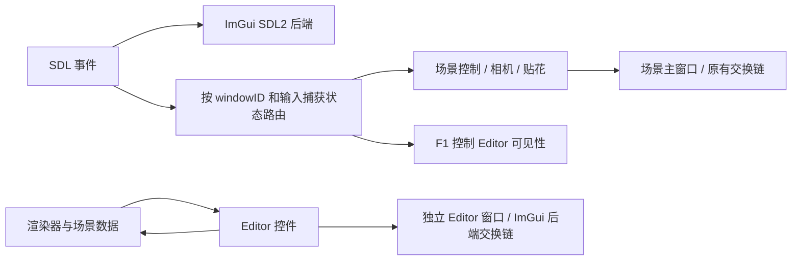

# 场景窗口与独立 Editor 工具窗口设计

日期：2026-10-11

## 目标与本版范围

保留现有 SDL2 场景窗口和自研渲染流程，把覆盖在场景上的 ImGui 控件迁移到独立的系统窗口，改善观察场景时的观感。用户可以单独移动、缩放、关闭工具窗口，或把它放到另一块显示器上。

本版迁移已有剔除统计、渲染开关、IBL 参数、PBRT 导出和 Mesh Picker 等控件；Vulkan 和 DX12 共用窗口行为。完整的场景层级、物体 Transform/材质 Inspector、精确 picking 和 ImGuizmo 操作轴属于后续扩展，本版不新增这些功能。

## 技术方案

- SDL2 保留为窗口、事件和输入后端。
- Dear ImGui 固定到官方 `v1.92.8-docking` 标签，子模块提交为 `b61e56346a92cfcaf1f43a545ca37b0b32239654`。
- 启用 `ImGuiConfigFlags_ViewportsEnable`，使用同一个 ImGui context 管理主视口与附加视口。
- `ConfigViewportsNoAutoMerge = true`：Editor 即使移到场景窗口范围内，也保持独立系统窗口。
- `ConfigViewportsNoDefaultParent = true`：场景窗口最小化时，Editor 不跟随最小化。
- `ConfigViewportsNoTaskBarIcon = false`：工具窗口可以通过系统任务栏访问。
- 使用 docking 分支提供的 multi-viewports 能力；本版没有 DockSpace，Editor 设置 `NoDocking`，不引入面板停靠布局。



两个窗口在同一进程内共享场景与渲染设置，不需要额外线程、第二套场景实例或进程间通信。

## 用户交互

| 操作 | 行为 |
| --- | --- |
| 启动桌面程序 | 默认打开场景窗口和 Editor 窗口 |
| 移动或缩放 Editor | 只改变工具窗口，不改变场景交换链或相机 |
| 点击 Editor 的关闭按钮 | 隐藏工具窗口，场景继续运行 |
| 按 F1 | 隐藏或重新打开 Editor；忽略按键自动重复 |
| 重新打开 Editor | 放回场景旁的默认位置，便于找回移出屏幕的窗口 |
| 最小化场景窗口 | 暂停场景绘制，继续更新和呈现工具窗口 |
| 关闭场景窗口 | 退出程序并清理所有视口资源 |

Editor 初始大小为 420 × 660，优先放在场景右侧，相隔 12 像素，并限制初始位置在场景所在显示器的工作区。显示器空间不足时，两个系统窗口可能重叠，用户可自行移动。

窗口布局写入运行工作目录下的 `editor-imgui.ini`，与旧的 `imgui.ini` 分离；该文件已加入 `.gitignore`。F1 重新打开会重置 Editor 的位置和大小；普通重启使用保存的布局。

## 代码职责

| 文件 | 职责 |
| --- | --- |
| `Src/Include/EditorUi.h` | 共用样式、平台判断、默认布局、可见性及附加视口呈现 |
| `Src/Include/SceneInput.h` | 根据 SDL 事件、主窗口 ID 和 ImGui 捕获状态决定是否传给场景 |
| `Src/Window.cpp` | 给 ImGui 转发完整事件流，再执行场景路由、F1 和退出逻辑 |
| `Src/GpuScene.cpp` / `Src/Include/GpuScene.h` | Vulkan UI 帧构建、原有控件、后端初始化与清理 |
| `Src/DX12/DX12GpuScene.cpp` / `.h` | DX12 UI 帧构建、原有控件、后端初始化与清理 |
| `Src/VulkanSetup.cpp` / `Src/Include/VulkanSetup.h` | 记录实际 graphics queue family，并查询呈现支持 |
| `ThirdParty/imgui` | 固定版本的上游核心与配套 SDL2/Vulkan/DX12 后端 |

## 帧循环与 GPU 资源

每帧先执行 ImGui 后端 `NewFrame()`、构建 Editor 控件并调用 `ImGui::Render()`。UI 参数更新发生在该帧场景绘制之前。

场景正常显示时，继续走原有渲染和主窗口呈现流程，然后执行：

```cpp
ImGui::UpdatePlatformWindows();
ImGui::RenderPlatformWindowsDefault();
```

主窗口最小化时跳过场景绘制，仍构建 UI 并执行附加视口呈现。Vulkan 获取交换链图像遇到过期并提前返回时，同样更新工具窗口。

### Vulkan

- 使用实际 graphics queue family，不再写死为 0。
- 开启 multi-viewports 前检查该 graphics queue 是否能对主场景 surface 呈现；附加 surface 的兼容性由上游后端检查。
- 主场景继续使用现有 render pass；附加窗口由 ImGui 后端维护交换链和对应渲染资源。
- 使用 `DescriptorPoolSize = 64` 让后端创建与固定版本匹配的描述符池，替换原先只有一个 combined image sampler 的池。
- 退出前等待设备空闲，再销毁附加窗口、Vulkan 后端、SDL 后端和 ImGui context。

### DX12

- 场景继续使用原有 device、命令列表和交换链；附加窗口资源由 ImGui DX12 后端管理。
- 退出时先等待场景 GPU 工作结束，随后调用 `ImGui_ImplDX12_Shutdown()`、`ImGui_ImplSDL2_Shutdown()`、`ImGui::DestroyContext()`。
- **不要在 DX12 后端关闭前显式调用 `DestroyPlatformWindows()`。** 主视口持有的是不含 command queue 的占位 renderer data，必须让 DX12 后端先释放它，再清理平台窗口；提前通用销毁会触发空指针访问。

## 输入隔离

所有事件先送入 ImGui SDL2 后端，保证工具窗口能接收移动、缩放、关闭和输入事件。场景侧再应用以下规则：

1. 键盘、鼠标移动、点击和滚轮必须属于场景窗口。
2. ImGui 捕获键盘或鼠标时，相应事件不传给场景控制。
3. F1 不受控件输入捕获阻止，用于恢复工具窗口。
4. 失焦、最小化及鼠标释放会清除相机拖拽状态；跨窗口释放也不能留下持续旋转。
5. 工具窗口关闭不会设置程序退出标记；场景窗口关闭或 `SDL_QUIT` 才退出。
6. 工具窗口的尺寸变化不能触发场景交换链重建。

现有 Mesh Picker 只在鼠标位于场景窗口且未被 ImGui 捕获时查询。SDL 窗口坐标先按场景交换链尺寸缩放，再执行射线查询，避免误用工具窗口坐标。

## 平台回退

当前为 SDL 的 Windows、X11、Cocoa 驱动启用桌面 multi-viewports；本机验证针对 Windows。Android、Wayland 或不满足 Vulkan 呈现要求的情况使用主窗口内的嵌入面板。

嵌入回退不显示关闭按钮，避免触屏用户关闭后无法通过 F1 恢复。其他桌面平台和 Android 尚未完成本次实机验证。

## 验证方法

### CPU 输入路由测试

`Tests/SceneInputTests.cpp` 覆盖工具窗口按键、点击、移动、滚轮、缩放、关闭，以及 F1、输入捕获、失焦和跨窗口释放。

```powershell
cmake -S Tests -B build-ibl-tests
cmake --build build-ibl-tests --config Debug
ctest --test-dir build-ibl-tests -C Debug --output-on-failure
```

### 真实 SDL/Vulkan 视口集成测试

`Tests/EditorViewportTests.cpp` 复用实际 `EditorUi`，创建真实窗口和 Vulkan 后端，断言主场景视口没有 Editor 顶点数据、独立视口有控件绘制数据，并验证移动、缩放、最小化、关闭重开、隐藏显示和清理。

```powershell
cmake -S Tests -B build-ibl-tests -DEDITOR_GPU_TESTS=ON
cmake --build build-ibl-tests --config Debug
ctest --test-dir build-ibl-tests -C Debug --output-on-failure
```

该测试需要有桌面会话和可呈现的 Vulkan 设备，因此默认关闭，不能在纯 CPU/headless CI 上直接运行。

### 完整程序窗口验收

`Tests/test_editor_windows.py` 仅操作它自己启动的进程窗口，检查真正的场景和 Editor 系统窗口，验证关闭重开、F1、最小化期间响应和正常退出。

```powershell
cmake --build build-msvc --config Debug --target AdvancedVulkanRendering --parallel 6
python Tests/test_editor_windows.py --backend vulkan
python Tests/test_editor_windows.py --backend dx12
```

日志保存在 `build-msvc/editor-<backend>-acceptance.log`。

## 当前验证状态

- 修正后的 Vulkan/DX12 联合编译通过，生成 `Bin/AdvancedVulkanRendering.exe`。
- 最终 CTest **12/12 通过**，包含 CPU/资产测试和真实 Vulkan 多视口集成测试。
- 完整 Vulkan 程序首轮运行 40 帧并正常退出。
- 最终完整 Vulkan 程序窗口验收通过：独立窗口、缩放、关闭重开、F1、最小化期间响应和正常退出。
- 最终完整 DX12 程序窗口验收通过，同样覆盖上述交互与正常退出。
- DX12 曾复现退出访问冲突，退出码 `3221225477`；修改后相同验收脚本通过，退出码为 0。
- 触屏回退关闭按钮问题已修改，独立代码审查确认两处修正合理；Android 尚未实机测试。
- 自动审批额度问题已解除，先前未执行的构建与验收已补齐。
- `git diff --check` 通过；ImGui 子模块自身工作区干净，仅更新父仓库引用的提交。
- 构建存在 MSVC/spdlog 弃用及 CRT 链接警告；Vulkan 运行日志还包含现有加载器/场景诊断输出，不能将本次成功运行表述为整个渲染器零警告。

## 后续扩展接口

后续可在 Editor 内加入场景树、选中物体属性和材质控件，通过选中对象 ID 访问现有场景数据，并用 dirty 标记更新 GPU 资源。ImGuizmo 的变换操作轴应绘制在场景视口，属性编辑留在独立工具窗口；接入时统一场景矩形、屏幕坐标和输入归属。
