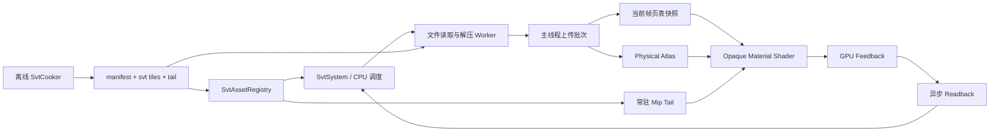

# Streaming Virtual Texture 设计：AdvancedVulkanRendering

日期：2026-10-16
状态：设计评审稿；本次交付设计文档，尚未实现或测量性能。
目标：在当前工程上增加可运行、可观察、可验证的桌面 Vulkan SVT 完整示例。用户选择的是完整示例范围；本仓库没有章节目录，因此集成基线为当前 `GpuScene` 渲染路径。

## 1. 结论与范围

推荐采用 **GPU 反馈 + CPU 请求调度 + 按 tile 的异步文件读取 + 固定容量物理 atlas + 软件页表 + 常驻 mip tail**。SVT 与现有整纹理 mip streaming 并存，材质通过独立元数据表选择采样路径。

借鉴 UE 的反馈闭环、生产与发布分离、格式分池、预算控制和驻留策略；首版不复制 UE 的共享虚拟地址分配器、多层 producer、页表区域继承更新以及 RVT。采用每资产独立虚拟地址、扁平 buffer 页表和 shader 显式查找父 mip，使状态与回收规则容易验证。

首版必须形成以下闭环：

1. 从现有桌面场景资源离线生成 tile 文件与常驻 tail。
2. 不透明材质的 albedo、normal、metallic/roughness、emissive 按需采样 SVT。
3. 快速移动或冷启动时先显示 tail/父 mip，加载完成后显示细节。
4. 固定 GPU 缓存预算内持续运行，正确处理淘汰、反馈溢出、慢 I/O、资源卸载。
5. 提供 ImGui 驻留视图、统计、自动化 CPU 测试与 GPU 回归场景。

首版边界：Windows 桌面 Vulkan；单主视图、非 MSAA 的不透明光栅路径；2D、尺寸为 2 的幂、Repeat 寻址；优先 BC1/BC3/BC5/BC7 与 RGBA8。具体格式须通过设备能力检查。正方形与长方形均可，进入 tile 区的 mip 必须满足压缩块对齐条件。不满足条件的资产保留旧路径并记录原因。

Alpha-mask、透明、阴影 alpha 测试、光追/path tracing、VLM bake、DX12、Android 使用原有纹理路径。共享给这些路径的纹理仍保留旧资源，不能因为光栅用了 SVT 就停止其加载。它们的完整 VT 支持属于后续工作；首版不宣称整个渲染器所有 pass 都完成虚拟纹理化。

## 2. 已核对的工程现状

以下结论来自当前工作区，而非仅根据仓库名称推断。工作区已有其他未提交改动，本设计不要求清理或覆盖它们。

| 当前实现 | 证据与设计影响 |
|---|---|
| 常驻低 mip 后，按整张纹理升级/降级 | `Src/Include/GpuScene.h` 的 `TextureStreamingEntry`、`PERMANENT_TEXTURE_SIZE=64`；`GpuScene.cpp::CreateTextures/UpdateTextureStreaming`。可以保留为兼容路径，不能直接视为 tile streaming。 |
| 按 submesh 包围球估算屏幕面积 | `UpdateTextureStreaming`、`calculateRequiredMip`。适合粗预取，不能准确识别 UV 中实际可见的页。 |
| 原纹理 blob 整体进内存 | `AAPLMeshData` 构造函数读取 `_textureData`；`loadMipTexture` 从内存按 mip 解压。仅改变 GPU 上传粒度不会降低这部分 CPU 内存。 |
| 后台解码，主线程处理 GPU 工作 | `blitThreadFunc`、`processStreamingWork`。后者调用同步的 `endSingleTimeCommands`；新 SVT 热路径不能沿用此等待模式。 |
| 材质通过 bindless 索引采样 | `shaders/drawcluster.hlsl` 的 `_Textures[]` 和 `AAPLShaderMaterial`，支持独立 side table，避免修改现有材质二进制布局。 |
| 两套帧索引有不同语义 | `GpuScene::Draw`：`_syncSlot` 对应 fence/cmd buffer，`currentFrame=imageIndex`。新增 SVT 资源明确使用 `_syncSlot`，不能照抄 `currentFrame`。 |
| 已有多种纹理消费者 | `drawcluster.hlsl` 的 base/forward/alpha-mask；`rt_path_common.hlsl` 的显式 LOD 采样；Shadow 与 VLM。必须逐路径定义兼容行为。 |
| C++/HLSL 双后端 | `Src/CMakeLists.txt`、`shaders/shadercompat.hlsl`。SVT 编译变体以 Vulkan 为首版，DX12 分支不引用新增资源。 |
| 已有 CPU 测试独立入口 | `Tests/CMakeLists.txt`。资产解析、地址计算、调度和回收策略可不依赖 Vulkan 测试。 |

入口文件链接：[GpuScene.cpp](../../../Src/GpuScene.cpp)、[GpuScene.h](../../../Src/Include/GpuScene.h)、[drawcluster.hlsl](../../../shaders/drawcluster.hlsl)、[帧索引说明](../../frame-vs-image-index-refactor.md)。

## 3. UE 参考的采用与修正

主参考为用户提供的 [UE5_SVT_Analysis.md](D:/SourceCode/L46/5.6merge/UnrealEngine5/UE5_SVT_Analysis.md)。并抽查同目录引擎源码，本文没有对其全部平台表与 CVar 默认值做完整复核。

| UE 概念 | 本项目对应 | 处理方式 |
|---|---|---|
| `FVirtualTextureSystem` | `SvtSystem` | 统一维护资产、请求、页状态和提交序号 |
| `FVirtualTextureSpace` | 每资产的 page directory + 全局扁平页表区间 | 不做共享二维虚拟空间分配 |
| `FVirtualTexturePhysicalSpace` / `FTexturePagePool` | `SvtPhysicalCache` | 按格式和颜色空间分池，固定预算，延迟回收 |
| `FUploadingVirtualTexture` | `SvtTileStreamer` | 文件 range read + 可选逐 tile LZFSE 解压 |
| `FVirtualTextureFeedback` | 每 sync slot 的 feedback/readback | GPU append，CPU 去重，非阻塞消费 |
| `PageTableUpdate.usf` | 当前空闲 slot 的页表 buffer 上传 | 首版不用 render-to-page-table 与区域传播 |
| Root/locked pages | 每资产常驻 mip tail | 作为独立普通小纹理，不占可淘汰 tile 槽 |

需要纠正的参考细节：

- 分析文档 §3.1 的反馈位布局与 §8.4 不一致。实际 `Engine/Shaders/Private/VirtualTextureCommon.ush:361–369` 为 X `[11:0]`、Y `[23:12]`、mip+1 `[27:24]`、space `[31:28]`。本项目使用自己的 `uint2` 请求布局，不拷贝 UE 的空间限制。
- `VirtualTexturePhysicalSpace.cpp::InitRHI` 使用常规 2D render-target pool 纹理作为物理缓存。文档将平台 SVT 与 Reserved/Sparse Resources 绑定的表述不能作为本设计的前提；首版不依赖 Vulkan sparse residency，也不据此判断 D3D11 是否支持 UE SVT。
- 分析文档中的 8-byte PageID/Count 与 shader 原始 append 请求不是同一个阶段的数据格式。本项目明确：GPU 输出请求，CPU 去重时累加 Count。
- UE 的页表可让缺页地址直接解析为较粗驻留页。本项目首版只保存精确驻留映射，通过父 mip 查找回退，两者更新算法不同。

## 4. 方案选择

| 方案 | 优点 | 成本 | 决策 |
|---|---|---|---|
| 软件 atlas + 精确页表 + shader 查父页 | 易验证，兼容普通纹理资源，无 sparse 硬件要求 | 缺页时有多次页表读取，需自定义采样 | **首版采用** |
| 软件 atlas + UE 式继承页表 | 通常一次查表可得到 fallback | 细页发布、父页淘汰需要更新覆盖区域和反向映射 | 测量查表成本后再引入 |
| Vulkan sparse image | 可保留部分原生虚拟图像采样语义 | 设备支持、稀疏粒度、mip tail、bind sparse 与反馈仍需管理 | 不作为首版依赖 |

扁平页表使用 `StructuredBuffer<uint>`，而非每资产一张 page-table texture：按 mip 的 offset 查找即可，减少描述符和整数纹理视图管理。后续可以替换页表后端，资产 tile 格式与 CPU 请求键保持稳定。

## 5. 架构与所有权



| 模块 | 责任 | 不承担的工作 |
|---|---|---|
| `SvtAsset` | 文件格式、校验、tile directory、CPU 地址数学 | 不创建 GPU 资源 |
| `SvtTileStreamer` | 有界任务队列、随机读取、解压、取消、返回不可变 tile 数据 | 不提交 Vulkan、不修改页表 |
| `SvtSystem` | 反馈去重、优先级、预算、generation、逻辑驻留 | 不直接组织场景绘制 |
| `SvtPhysicalCache` | format pool、槽位状态、LRU、退休序号 | 不决定材质 UV/LOD |
| `SvtVulkanRuntime` | descriptor、atlas、staging/readback、页表快照和 barriers | 不拥有场景资源解析逻辑 |
| `svt_common.hlsl` | LOD、查表、tail 回退、滤波、反馈编码 | 不决定磁盘布局 |

渲染线程唯一拥有可变页表与缓存元数据。Worker 只接收资产句柄、generation、tile key 和独立文件读取上下文；完成队列不携带可失效的 `GpuScene` 裸指针。资产注册后元数据只读，文件句柄通过共享任务所有权保活。

建议接口契约（设计接口，不代表现有代码）：

```cpp
struct SvtAssetHandle { uint32_t index; uint32_t generation; };
struct SvtTileKey { SvtAssetHandle asset; uint32_t mip, x, y; };
struct SvtFrameContext {
    uint32_t syncSlot, imageIndex;
    uint64_t nextSubmissionSerial, completedSubmissionSerial;
};

// CPU 系统：读已完成反馈、合并 worker 结果、产生有预算的不可变批次。
SvtFrameBatch SvtSystem::prepareFrame(const SvtFrameContext&);
// 在当前主 command buffer、任何纹理采样前录制 copy 与页表发布。
void SvtVulkanRuntime::recordUploads(VkCommandBuffer, const SvtFrameBatch&);
// 所有参与反馈的 pass 完成后复制反馈到对应 readback slot。
void SvtVulkanRuntime::recordFeedbackReadback(VkCommandBuffer, uint32_t syncSlot);
// 只有 vkQueueSubmit 成功，才提交逻辑发布状态与 slot 对应 serial。
void SvtSystem::commitSubmittedBatch(const SvtFrameBatch&, uint64_t serial);
void SvtSystem::cancelUnsubmittedBatch(const SvtFrameBatch&);
```

`SvtFrameBatch` 拥有本次 staging 引用、待发布映射、退休操作、目标页表版本；录制失败或 acquire 失败时不能把尚未提交的映射当成已驻留。提交失败视为渲染器错误，停止继续使用其未提交状态。

## 6. 资产与离线切片

### 6.1 文件布局

每个源纹理输出一个 `.svt`，场景旁输出 manifest。不修改原 `.dxt.bin`，不在运行时首次访问 tile 时重新解码整张大纹理。

| 区域 | 字段与约束 |
|---|---|
| Header | magic、version、headerSize、little-endian 标记、宽高、mipCount、tileSize、border、format、colorSpace、addressMode、tailFirstMip、directory offset/count、tail offset/size、source content hash |
| Mip directory | 每 mip 的 texelWidth/Height、tilesX/Y、firstEntry；所有 offset 和文件长度使用 uint64 |
| Tile directory | 按 mip/y/x 排序；每 tile 的 fileOffset、storedSize、decodedSize、codec、CRC32 |
| Tile payload | 含边框的 GPU-native blocks；codec 0 为直接读取，codec 1 为单 tile LZFSE |
| Tail | 从 `tailFirstMip` 到 1×1 的完整普通纹理 mip 链与各 mip offset |

不直接序列化带 padding 的 C++ struct。字段按版本逐项读写，做有界整数运算；offset+size、mip 数量、tile count、decodedSize、CRC 必须校验。manifest 使用源规范化路径、原 `_pathHash` 和内容 hash 建立映射，不能单独信任可能碰撞的 32-bit path hash。

建议默认 `T=128`（内部 texel）、`B=4`（每侧边框）、`P=T+2B=136`。`tailFirstMip` 是第一个宽和高均不大于 128 的 mip；小纹理整个作为 tail，不生成可流送页。

### 6.2 Cooker 的可实现路径

读取现有 `.dxt.bin` 的纹理目录，逐 mip 解开 LZFSE 得到原有 BC blocks。对满足条件的 BC mip，以 4×4 block 为单位复制内部与邻居块；128 和 4 都对齐 block，136×136 是 34×34 blocks。Repeat 外边界用源 mip 的 block 坐标取模。保留源 mip 链，不做 atlas 全图 mip 生成。

当某一维小于 tile 时，页内剩余区域也按该维真实尺寸重复填充；shader 使用真实 texel 尺寸计算局部坐标。每个流送 mip 的维度需可按完整 block 处理；不满足条件则拒绝该资产的 BC 切片转换，保留旧路径。RGBA8 路径按 texel 执行相同规则。首版不新增在线 BC 编码器。

该 block-copy 方法只承诺 Repeat 与已有正确 mip 的资产；Clamp/Mirror 边界需要按 texel 正确扩展再编码，列入后续资产能力，不能靠复制整块边缘冒充正确 Clamp。

颜色空间、通道语义保持源资源含义：base color/emissive 是否 sRGB 由元数据决定；normal、roughness 等数据纹理为线性。normal 的 mip 必须来自有效源链；独立生成测试纹理 mip 时须按向量过滤并归一化。

### 6.3 运行时的真实磁盘流送

启用 SVT 时，`AAPLMeshData` 必须新增“纹理 blob 延迟读取”模式：解析纹理描述后记录 blob 文件基址和长度，seek 跳过 blob；原构造路径继续保留给 DX12/Android/关闭 SVT 的场景。

兼容纹理使用文件 range reader 按 mip 读取原格式，统一替换旧 streaming 中直接计算 `_textureData + offset` 的数据来源；不要让 `_textureData=nullptr` 后仍调用旧指针路径。SVT 的 tile 和 tail 从 `.svt` 读取。这样 mixed 场景也不必保留完整原纹理 blob。

加载 manifest、版本、格式或源 hash 校验失败时，在资产注册阶段选择旧路径。运行中单 tile 读失败只回退父页/tail，不在渲染线程临时同步加载整张纹理。

## 7. 虚拟地址、页表和物理缓存

### 7.1 每资产地址

```text
width_m = max(1, width >> m), height_m = max(1, height >> m)
tilesX_m = ceil(width_m / T), tilesY_m = ceil(height_m / T)
pageIndex = asset.pageBase + mipOffset[m] + y * tilesX_m + x
```

只为 `0 <= m < tailFirstMip` 分配页表。对一张 16384² 纹理，T=128：128²+64²+…+2²=21,844 项，每份 uint32 页表为 87,376 bytes；三份约 256 KiB。单资产开销小，但注册许多资产后必须计入总预算和 `maxStorageBufferRange`。

CPU 保留 authoritative table；GPU 每 `_syncSlot` 保存独立快照。每槽记录 `appliedVersion`，重用时从 CPU 镜像应用变更；首版合并相邻变更为 copy ranges，变更日志过大时重传完整快照。元数据表在场景注册后固定；增删资产和重建容量必须走退休协议或显式场景重建。

每个 entry 32 bit：bit31 为 valid，bits[19:0] 为 slot index，其余保留为 0；pool index 从资产描述获取。slot 0 是合法地址，invalid 不能与 slot 0 混淆。首版同一资产只有一个 format pool，tail 独立。

**页表只存精确页。** 查请求 mip 失败就从 UV 重新计算父 mip 页坐标并继续，直到 tail。无需将父映射铺满所有子项，也无需在淘汰父页时遍历子页反向映射。16384² 的最坏查找为 7 个 tile mip；统计实际查表深度决定是否升级 UE 式继承页表。

### 7.2 物理池

Pool key 为 `{VkFormat（含 sRGB/UNORM 区别）, T, B}`。不同 block 格式或颜色空间不混用同一 atlas；normal 的 BC5 与 albedo 的 BC7 不共享 pool。每池一张普通 2D image，只有 mip0，usage 为 `SAMPLED | TRANSFER_DST`。

```text
slotsPerRow = floor(atlasDimensionLimit / P) 内选满足预算的整数
atlasWidth = slotsPerRow * P
slotX = slot % slotsPerRow
slotY = slot / slotsPerRow
```

每池可以使用矩形 slot 网格；行列数和实际分配字节由 GPU limit 与全局预算共同决定。不默认每种格式都分配一个最大 atlas。首版 pool 容量启动时确定，运行中不扩容、不更换 descriptor。

槽状态：`Free → Reserved → UploadQueued → Resident → Retiring → Free`。读取/解压阶段不占槽；已有 payload 且本帧上传预算通过后再预留。所有权、generation、publishedSerial、retireSerial、lastSeenFrame、lastRequestedFrame 分开记录。

常驻 tail 不参与 LRU。Atlas 保留约 10% 的可周转容量（至少本帧最大上传页数，容量很小时相应下调预算）；若全部槽为 Resident/Retiring，停止新上传并继续显示 fallback，绝不能直接覆盖活跃页。

## 8. Shader 采样与反馈

### 8.1 材质绑定

保留 `AAPLShaderMaterial` 和现有纹理索引，新增 `SvtMaterialBindings[materialIndex]`，其中四个槽各有 `assetIndex`，无 SVT 时为 `0xffffffff`。`SvtAssetGpuDesc` 包含 generation、真实尺寸、mip offset、tailFirstMip、poolIndex、tailTextureIndex、颜色/通道标志。

仅新增不透明 SVT shader 变体和对应三组 layout：set0 global、set1 原 appl、set2 SVT。set2 明确绑定 `svtDescriptorSets[_syncSlot]`，原 set0/set1 仍按当前工程的 `imageIndex`。不为其他 shader 强制添加读写 feedback binding。

建议 set2：0 资产元数据 SSBO；1 材质 side table；2 页表 SSBO；3 atlas sampled-image 数组；4 tail sampled-image 数组；5 bilinear sampler；6 feedback UAV；7 frame constants。数组以实际固定容量完整填充有效资源，索引经过边界验证并在 shader 用 `NonUniformResourceIndex`。tail sampler 与 atlas sampler 首版均禁用 anisotropy；tail 使用显式虚拟 mip 对应的 LOD。

### 8.2 LOD 与坐标

首版使用可预测的双线性 + 手动三线性，不依赖 TAA 掩盖 mip 跳变；各向异性作为后续优化，不能只改全局 sampler 就宣称支持。

```text
du = ddx(uv) * float2(width, height)
dv = ddy(uv) * float2(width, height)
lambda = clamp(log2(max(max(length(du), length(dv)), epsilon)) + mipBias,
               0, mipCount - 1)
m0 = floor(lambda); m1 = min(m0 + 1, mipCount - 1)
result = lerp(SampleVirtualMip(m0), SampleVirtualMip(m1), frac(lambda))
```

导数在 Repeat 的 `frac(uv)` 之前计算，并在非一致分支外取得。每个候选 mip 的查找都使用 Repeat 后的 UV，避免 UV=1 和负 UV 越界。

找到实际驻留 mip `r` 后：

```text
texel = frac(uv) * float2(width_r, height_r)
pageXY = floor(texel / T)
local = texel - pageXY * T
physicalUV = (float2(slotX, slotY) * P + B + local) / atlasExtent
color = atlas.SampleLevel(bilinearSampler, physicalUV, 0)
```

这是归一化纹理坐标约定：texel center 对应 `i+0.5`，不能再无条件给 physicalUV 加半 texel。取父页后必须按实际 `r` 重算坐标，不能沿用原请求 mip 的 frac。边框来自同一 mip 的邻居数据，跨页双线性才连续。

若到达 tail，则对 tail 使用 `SampleLevel(repeatSampler, uv, requestedMip-tailFirstMip)`；当从更细 mip 缺页回退到 tail 时 LOD clamp 至 0。两路三线性分别回退，正常驻留时与原 mip 链的三线性含义一致；不同时到达会出现短暂清晰度变化，统计并验收，不承诺完全无 pop。

### 8.3 反馈格式与采集

每条 GPU feedback 为两个 uint32，不要求 64-bit 原子：

```text
word0: assetIndex [15:0] | generation16 [31:16]
word1: pageX [11:0] | pageY [23:12] | mip [27:24] | reserved=0 [31:28]
```

工程资产句柄用 uint32 generation；编码只携带低 16 位。generation 低位将回绕时，必须排空全部相关 feedback/worker/GPU 引用后再重用该 assetIndex；正常情况下单调递增即可。首版单边最大 16384、T=128，坐标与 mip 位数有余量，注册时仍检查上限。

Feedback buffer = 16-byte header（attemptCount、overflowCount、两个保留字段）+ capacity 个 `uint2`。线程 `InterlockedAdd(attemptCount,1,index)` 后仅在 `index<capacity` 时写；CPU 只读 `min(attemptCount,capacity)`。初始化与逐帧清 header 都有 transfer→fragment barrier。

默认每 8×8 屏幕块选一个随帧变化的位置。选中像素最多记录四个纹理槽、每槽 m0/m1 两个请求；去重留给 CPU。shader 只反馈真实存在的槽，tail 范围不需要发 tile 请求。所有请求写完之后才复制 readback，不能把原子计数递增当作同一 shader 内的数据发布屏障。

**命中也反馈**，用于驻留热度；反馈的是期望 mip，而非只报实际 fallback mip。CPU 同时沿当前驻留层级找到 fallback 并 touch，避免持续使用的父页因缺少直接请求被淘汰。首版不透明 SVT fragment entry 采用 early depth/stencil，减少被遮挡片元写反馈；这不是完全精确的可见性判定。

1080p、factor=8，约 32,400 个采样位置，四槽×双 mip 的理论基本负载约 259,200 条；默认 capacity=262,144（约 2 MiB），保留溢出计数。过绘制仍可溢出。4K 或高过绘制时增加 factor、容量或减少预算，不能假定分辨率缩小后一定无溢出。

## 9. 请求、I/O 与预算

请求状态：`Missing → Queued → Reading → Ready → UploadQueued → Resident`；失败进入 `RetryAfter`，取消/卸载进入 `Cancelled`，淘汰走物理槽退休协议。CPU 哈希键为完整 `{assetIndex,generation,mip,x,y}`，合并重复请求并饱和累加 Count。

调度顺序采用明确的词典序：显式预取优先级 → 当前粗缺口 → 屏幕反馈 Count → 等待年龄 → 稳定 tile key。不能只偏爱细 mip 导致始终没有可靠中间清晰度。

冷启动缺页时，对同一 tile 路径补齐尚未驻留的祖先请求，先安排最粗的缺失祖先，再逐级细化；已有 Ready 数据也受每帧字节和页数预算。一个 tile 只允许一个未完成任务，过期结果用 generation/request token 丢弃。

| 配置 | 示例初值 | 约束 |
|---|---:|---|
| atlas 总预算 | 128 MiB | 所有 format pools 的实际分配总和，不是每池 128 MiB |
| pinned tail 预算 | 32 MiB | 超出时拒绝新 SVT 资产注册，改走兼容路径 |
| 上传预算 | 32 pages/frame 且 4 MiB/frame | 先命中的限制生效，按解压后的上传字节计 |
| I/O worker | 2 | 每 worker 独立读取上下文 |
| pending tile requests | 8192 | 满时保留高优先级，低优先级依赖后续反馈重试 |
| CPU Ready payload | 32 MiB | 计入 Reading 预留与 Ready 字节，形成背压 |
| GPU feedback capacity | 262,144 | 满时截断，帧统计显示 overflow |
| feedback factor | 8 | 更密反馈与读取/原子成本之间的取舍 |
| readback 资源 | 每 sync slot 一份 | 只消费完成的 submission，不设固定“3 帧即安全”规则 |
| staging | 每 slot 至少 4 MiB + 页表更新空间 | 未完成的提交不能复用 |
| CPU 去重处理时间 | 目标 1 ms/frame | 超出时分批；不是已验证性能保证 |

相邻 tile 读取可合并但首版不引入复杂 chunk cache。CRC/短读错误最多重试 3 次，退避 100/500/2000 ms；持续失败时对本次资产 generation 标记坏页并保留 fallback。卸载资产后不再重试。

LRU 使用反馈帧号做热度，不承担同步证明。热点超过缓存且持续出现淘汰/重新请求时，可启用带滞回的全局 mip bias：例如压力连续 30 帧超过阈值提高 0.25，稳定 120 帧后降低 0.25，限制 [0,4]；反馈丢弃/overflow 期间禁止仅凭“未见”大规模淘汰。数值均为可调初值。

## 10. Vulkan 同步：正确性的核心约束

### 10.1 首版采用单 graphics queue 上传

异步指 CPU 文件读取/解压与渲染重叠；GPU copy 先在主 graphics command buffer 批量执行。这样不需要新增 transfer queue ownership 和 semaphore 依赖。稳定运行中 SVT 不调用 `vkQueueWaitIdle/vkDeviceWaitIdle`，只使用现有帧槽等待和已完成反馈。

每个实际提交生成单调 `submissionSerial`，成功完成的 fence 更新 completed serial。映射为 `{syncSlot, serial}`，必须在 fence reset/reuse 前采集完成状态，不能把被复用的 fence 句柄当作永久完成凭证。

```text
Draw:
  wait inFlightFences[syncSlot]；登记该槽旧 submission 完成
  acquire image；遵守现有 imagesInFlight 等待
  消费已完成 readback；准备 bounded frame batch
  begin current command buffer
    清本槽 feedback header
    对需要写入的 atlas 建立旧采样 → transfer 依赖
    copy tile payload → atlas
    copy 当前槽页表快照（含本批新增映射）
    transfer → fragment read/write barriers
    不透明 SVT pass（set2 使用 syncSlot）
    其他现有 pass
    fragment writes → transfer reads；copy feedback → readback
    transfer writes → host reads barrier
  submit 成功：提交批次和 serial
  present
```

Acquire 失败时不 reset/提交新的 SVT slot 状态；已完成反馈可在下次消费。示例接入现有 `Draw` 时，应把可失败的批次准备放在 reset fence 前，或沿用渲染器明确的失败恢复路径。

Barrier 设计约束：atlas 用 `SHADER_READ_ONLY_OPTIMAL → TRANSFER_DST_OPTIMAL → SHADER_READ_ONLY_OPTIMAL`，源 stage/access 覆盖所有实际采样方，目标为 transfer write，再回 fragment sampled read；不将已存在 atlas 从 UNDEFINED 开始以免丢弃其他 tile。页表 copy 后为 transfer write→fragment shader read；feedback 清零为 transfer write→fragment shader read/write，复制前为 fragment shader write→transfer read。CPU 读取 readback 前必须有 GPU 完成证明，并对非 coherent 内存 invalidate；CPU 写 staging 后按需 flush，对齐 nonCoherentAtomSize。实现可用工程现有 legacy barrier API，不强行增加 synchronization2 依赖。依据：[Khronos 同步示例](https://docs.vulkan.org/guide/latest/synchronization_examples.html)。

同队列的提交顺序本身不能替代内存/执行依赖；atlas 的 layout transition 覆盖整张单 mip image，需等待之前提交对该 atlas 的采样。这是首版可接受的 GPU 串行成本，应计入上传耗时。

### 10.2 发布新页

只有读取和校验成功的 payload 才能安排上传。当前 frame batch 中先 copy tile，再更新页表快照，经过 barrier 后本帧 draw 才能看到映射。CPU authoritative table 在 submit 成功时提交；其他 slot 再次使用前同步新版本。上传 staging 一直保留至该 serial 完成。

### 10.3 淘汰与复用

**删掉 CPU 表项不等于可以覆写 atlas。** 其他 slot 的旧页表可能仍引用该物理槽。

1. 从 authoritative table 删除映射，记录 unmapVersion，槽进入 Retiring。
2. 所有未来提交必须使用不含旧映射的新快照；旧快照在 slot 再次提交前必须补齐版本。
3. 记录所有已经提交且可能引用该槽的 serial，取最大值为 retireSerial。
4. 当 `completedSerial >= retireSerial`，且没有正在录制、尚未提交的批次引用旧映射，槽才可 Free。
5. 已完成但未更新的闲置快照不阻止回收，前提是绝不能直接重提交它；重用前必定从 authoritative table 重新同步。debug 模式检查快照版本与槽所有权。

`Retiring` 槽禁止被“取消淘汰”后立即重新映射；若再次被请求，等待退休结束再重新上传，首版优先保证状态单向清晰。容量紧张时靠空闲储备和帧预算保证进展，而非绕过退休。

资产卸载同时取消任务、增加 generation、撤销映射；descriptor、tail、元数据区间释放也等待最后使用 serial。窗口 resize 时可以重建 swapchain 相关对象；SVT slot 数若变化，要等相关旧提交完成再重建 slot 资源，CPU 请求与 atlas 可保留。

## 11. 接入点与兼容路径

| 文件 | 设计改动 |
|---|---|
| 新增 `Src/Include/SvtAsset.h`、`Src/SvtAsset.cpp` | 版本化文件格式、目录验证、地址计算、range reader |
| 新增 `Tools/SvtCooker.cpp` | 从场景资源提取 mip、构造边框、写 tile/tail/manifest；生成诊断纹理 |
| 新增 `Src/Include/SvtSystem.h`、`Src/SvtSystem.cpp` | 调度、generation、驻留状态、CPU 页表镜像 |
| 新增 `Src/Include/SvtTileStreamer.h`、`Src/SvtTileStreamer.cpp` | I/O worker、背压、取消与错误状态 |
| 新增 `Src/Include/SvtPhysicalCache.h`、`Src/SvtPhysicalCache.cpp` | 格式分池策略、槽分配、退休与预算统计 |
| 新增 `Src/Include/SvtVulkanRuntime.h`、`Src/SvtVulkanRuntime.cpp` | GPU 资源、描述符、上传/readback、barrier |
| 新增 `shaders/svt_common.hlsl` | 共享采样和反馈函数 |
| `Src/Include/GpuScene.h`、`Src/GpuScene.cpp` | 只增加系统成员与生命周期/Draw hook；延迟读取纹理数据；创建 SVT pipeline/layout |
| `shaders/drawcluster.hlsl` | 不透明 base/forward 变体使用统一 `SampleMaterialTexture` helper；其他变体维持旧分支 |
| `Src/VulkanSetup.cpp` | 明确查询并确认 fragmentStoresAndAtomics、格式采样/过滤与 descriptor limits；能力不足关闭 SVT |
| `Src/Window.cpp`、`Src/Include/EditorUi.h`、`GpuScene::buildImGuiFrame` | 参数传入、控制项与只读统计；按现有 UI 分工接入 |
| `Src/CMakeLists.txt`、根 CMake、shader 编译脚本 | 加入模块、cook 工具、SVT_ON 编译变体；DX12 保持非 SVT 变体 |
| `Tests/CMakeLists.txt` 与新增 Svt 测试 | 纯 CPU 与可选 GPU 测试目标 |

资源 binding 编号属于新 set2，仍需在实现阶段做 shader reflection/pipeline layout 校验；不占用已有 set1 的 IBL/VLM binding。SVT 关闭时不产生反馈或多余页表访问。

首版使用模式固定于场景加载：`--svt=off|on`、manifest 路径、pool/tail budget。ImGui 可以暂停读取、冻结反馈、修改 bias/预算上限、显示 debug view；切换模式或物理 pool 大小通过显式场景重载，避免把全局资源迁移混入第一版。

与其他路径共享纹理时，原 `_Textures` 保持旧资源；tail 使用独立描述符数组，不能用低分辨率 tail 偷换原纹理而让 RT/alpha-mask 画质静默退化。性能统计分别展示 legacy 与 SVT 字节，这种双份驻留是兼容成本，不算作缓存泄漏。

## 12. 内存与可观测性

以 128+4×2 tile 为例：

| 格式 | 单 tile payload | 1024 slots 的 payload |
|---|---:|---:|
| BC1（8 bytes/block） | 34×34×8 = 9,248 B | 9.03125 MiB |
| BC3/BC5/BC7（16 bytes/block） | 18,496 B | 18.0625 MiB |
| RGBA8 | 136×136×4 = 73,984 B | 72.25 MiB |

边框面积增量约 12.89%。32×32 slots 的 atlas 为 4352²；选择尺寸时检查 `maxImageDimension2D`。以上仅 payload，实际 `vkGetImageMemoryRequirements` 的 size/alignment 才是 GPU 预算记账依据。

32 页 BC7 上传为 591,872 B/frame，60 fps 约 33.87 MiB/s；RGBA8 为 2,367,488 B/frame，约 135.47 MiB/s。这是预算上限估算，不是磁盘实测吞吐；mip tail、页表、对齐和其他资源另算。

总内存需要分账：atlas + pinned tails + 每 slot 页表 + feedback + readback + staging + CPU 页表/请求/Ready + legacy GPU/CPU 资源。只展示 atlas 大小会误导对 SVT 节省效果的判断。启动时做 tail 与 directory 预算准入，运行时所有队列和 payload 必须有界。

ImGui 至少展示：各格式池 capacity/resident/retiring/free、tail bytes、请求去重前后数量、missing/parent/tail 命中比例、平均查表层数、uploaded pages/bytes、read bytes、I/O 延迟、请求到首次可见的延迟、feedback overflow、retry/bad tiles、ready bytes、evictions/re-requests、mip bias。

调试视图：请求 mip、实际 mip、虚拟 tile 网格、物理 slot 着色、fallback 深度、atlas 查看。debug view 必须可单独关闭，避免将诊断原子开销计入发布采样性能。

## 13. 验证与验收

### 13.1 CPU 测试

- 地址与编码：正方形/长方形、tail 边界、负/整数 Repeat UV、最大合法值、非法坐标、generation 回绕协议、反馈容量为 0/满/溢出。
- 资产：截断 header、错误版本、offset 溢出、错误 decodedSize/CRC、重复目录项、hash 不匹配、block 对齐失败；不能超范围读或分配无界内存。
- Cooker：136² 边框与整张源 mip 的 Repeat 采样一致；页角四邻居、短边小于 128、BC block-copy 保留字节与 tail mip 索引正确。
- 状态机：重复请求只产生一次读取；慢 I/O + 卸载 + assetIndex 重用，旧结果全部丢弃；Ready/Reading 背压和失败退避有效。
- 退休：模拟乱序 image acquisition、2/3 个 sync slot、GPU 延迟、闲置旧快照、未提交 batch；任何活跃快照引用的 slot 不可被覆盖。
- 预算：大量纹理格式、所有槽 Retiring、tail 超预算、请求超容量，系统有界并保持 fallback 可用。

### 13.2 GPU 与视觉回归

建立确定性诊断场景：大平面 + 斜面/立方体，包含跨 tile 网格、每 mip 不同颜色、Repeat UV、长方形纹理；再接入已有 Bistro 资产。验证 pass 使用与生产相同的采样函数。

1. 关闭 streaming，将测试页全驻留，与普通纹理参考图比较：无跨页接缝、错误颜色空间、normal 通道差异。严格对比使用同一 mip 链、相同双线性/三线性、关闭 anisotropy/TAA；避免把旧全局 sampler 差异归因于 VT。
2. 冷缓存、原地转身、相机传送、快速飞行：允许短暂模糊，不允许黑块、随机旧 tile 或错误材质串页。
3. 缓存缩至工作集以下循环运动；开启 GPU 延迟与慢 I/O 注入；Validation（含同步检查）无 SVT 相关读写和 layout 错误。
4. 1/2/3 个 in-flight slots、非顺序 imageIndex、resize、最小化再恢复、卸载/重载至少循环 100 次，无增长泄漏、悬空任务或死锁。
5. 强制 overflow、丢弃反馈、损坏 tile、缺失文件、能力不足：符合各自 fallback 策略，统计可见。
6. SVT on/off 都运行 alpha-mask 阴影、透明、RT、VLM、DX12 非 SVT 编译回归；这些路径不能因为 ABI/layout 修改而失效。

### 13.3 性能验收方法

固定 GPU、驱动、分辨率和相机路线，记录 CPU frame、GPU frame、SVT CPU/GPU 阶段、峰值内存、miss ratio、收敛延迟的 p50/p95/p99。比较旧 mip streaming、SVT 冷缓存、SVT 热缓存；同等画质/可见 mip 才有意义。

功能硬门槛：预算不超限（含 allocator 对齐）、无 SVT 热路径 queue/device idle、无等待磁盘的 render-thread 阻塞、无错误页复用、无无限队列、缺页始终有合法 fallback。性能目标暂定 1080p 下新增 CPU p95 ≤1 ms、热缓存 GPU 增量 p95 ≤1 ms；这是实施后的调优目标，必须以指定硬件实测决定是否达成。

## 14. 交付里程碑

这是设计中的实施顺序，尚不是逐条代码实施计划。

| 阶段 | 可运行产物 | 完成判据 |
|---|---|---|
| M1 资产与地址 | Cooker + 文件 reader + checker/mip-color 诊断资产 | tile/tail/边框/恶意文件 CPU 测试通过，可真实按 range 读取 |
| M2 全驻留采样 | atlas + 页表 + tail + 不透明采样 + debug views | 与普通纹理参考一致，先不启用反馈驱动淘汰 |
| M3 反馈到读取闭环 | feedback/readback + 去重调度 + I/O worker | 相机移动能按 tile 读取并细化，队列有界，无同步上传等待 |
| M4 固定预算回收 | 发布事务 + serial 退休 + LRU + 背压 | 小缓存、慢 GPU/慢 I/O、generation 测试通过，无串页 |
| M5 工程完整示例 | Bistro manifest、blob 延迟读取、UI、兼容路径和回归报告 | 可以复现实验，内存/延迟统计完整，SVT on/off 可比较 |

后续按测量结果选择：UE 式继承页表与 GPU 更新、GPU feedback compact、各向异性采样和更大 border、异步 transfer queue、多层材质 stack 共用一次 lookup、非 POT/Clamp/Mirror、alpha-mask 专用反馈、ray-cone LOD/RT feedback、移动格式、DX12 后端。RVT、UDIM 与硬件 sparse 单独立项，不混入首版验收。

## 15. 主要风险与决策依据

| 风险 | 对应决策 |
|---|---|
| 把 RAM 中整 blob 解压误称为磁盘 streaming | 首版包含延迟 blob 读取和独立可寻址 tile 文件 |
| 用固定 N 帧延迟回收造成慢 GPU 串页 | 以提交完成 serial + 未来快照版本规则判断可复用 |
| 只反馈 miss 导致热页被淘汰 | 命中也反馈，CPU touch 实际 fallback 链 |
| 只发细 mip 请求，冷启动长期模糊 | 合成祖先请求，粗缺口优先 |
| 新页表可见而内容未上传完 | 同 batch 先 copy 后 barrier，再采样，submit 后才提交逻辑状态 |
| 格式池碎片、兼容路径重复驻留 | 全局按实际分配预算，分项显示 legacy/SVT 内存 |
| atlas mip/错误导数造成接缝 | atlas 只有 mip0；完整源 mip 离线切片，导数在 frac 前计算 |
| tail 被用作原纹理而破坏光追/alpha | 独立 tail 描述符，非 SVT 消费者保留旧纹理 |
| 给巨大 `GpuScene.cpp` 继续堆逻辑 | 子系统独立文件，GpuScene 仅生命周期与提交接入 |

## 16. 参考来源

- 用户指定的 UE 5.6 分析：[UE5_SVT_Analysis.md](D:/SourceCode/L46/5.6merge/UnrealEngine5/UE5_SVT_Analysis.md)。
- 实际反馈编码：[VirtualTextureCommon.ush](D:/SourceCode/L46/5.6merge/UnrealEngine5/Engine/Shaders/Private/VirtualTextureCommon.ush)，重点 333–369 行。
- 实际物理池创建：[VirtualTexturePhysicalSpace.cpp](D:/SourceCode/L46/5.6merge/UnrealEngine5/Engine/Source/Runtime/Renderer/Private/VT/VirtualTexturePhysicalSpace.cpp)，重点 `InitRHI`。
- Epic [Streaming Virtual Texturing](https://dev.epicgames.com/documentation/unreal-engine/streaming-virtual-texturing-in-unreal-engine?lang=en-US)：可见 tile 反馈与 reactive streaming 的概念参考；线上文档不用于断言本地 5.6 的所有默认值。
- Epic [Virtual Texture Memory Pools](https://dev.epicgames.com/documentation/unreal-engine/virtual-texture-memory-pools-in-unreal-engine?lang=en-US)：物理池与 tile 尺寸概念参考。
- Khronos [Synchronization Examples](https://docs.vulkan.org/guide/latest/synchronization_examples.html)：上传、读回、内存可见性依据。

本文所有预算、模块名、接口、采样简化和阶段安排均为针对本工程的设计建议；与 UE 已实现机制、当前仓库已具备功能和未来扩展明确区分。
